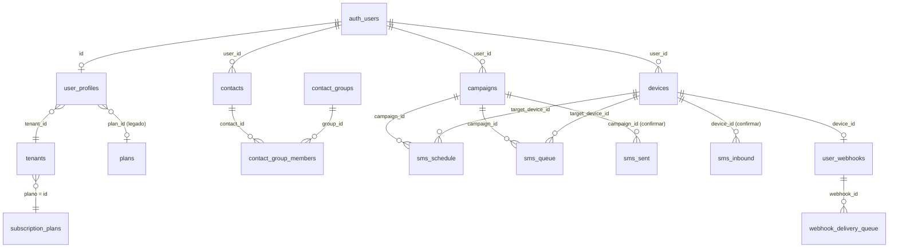

# Banco de dados - tabelas e relações

Este documento descreve as tabelas do Supabase (Postgres) que o sistema lê e grava, as relações entre elas, as
funções (RPC) e as regras de acesso. Ele foi montado a partir do que o código usa (frontend em `src/` e Edge
Functions em `supabase/functions/`). **O repositório não tem migrations**: tipos e restrições abaixo marcados como
"confirmar" precisam ser conferidos no seu banco.

## Visão geral das relações



## Fluxo das mensagens

```
campanha criada (SendCampaign)
   |-- 1ª mensagem de cada chip, se já devida --> sms_queue (PENDING)
   '-- demais mensagens ------------------------> sms_schedule (WAITING)
                                                       |
                      job pg_cron (scheduled_for <= now) | preserva campaign_id
                                                       v
                                                  sms_queue (PENDING)
                                                       |  app Android envia
                                                       v
                                      SENT / DELIVERED / FAILED  (+ sms_sent, sms_failed)
```

Recebimento: o app grava em `sms_inbound`; um processo cria itens em `webhook_delivery_queue` para o
`user_webhooks` do aparelho, e o `pg_cron` os entrega à URL do usuário com retentativas.

---

## Tabelas

### Identidade, tenant e planos

**`tenants`** - a conta (cliente). É a fonte principal de plano e limites.
| Coluna | Uso |
|---|---|
| `id` | PK; enviada ao checkout e atualizada pelo webhook do Stripe |
| `email` | localizar o tenant do usuário logado |
| `name` | exibido no perfil |
| `plano` | FK lógica para `subscription_plans.id` (`FREE`, `STARTER`, `PRO`, `PLUS`) |
| `max_devices`, `max_monthly_sms`, `max_contacts` | limites efetivos (têm prioridade sobre o catálogo) |
| `is_master` | superadministrador: ignora limites e faturamento |

Só a service role (webhook do Stripe) deve alterar `plano`. Usuários comuns não podem editar `is_master`.

**`subscription_plans`** - catálogo de planos comerciais.
`id` (PK texto), `name`, `description`, `price_brl`, `price_usd`, `max_devices`, `max_monthly_sms`, `max_contacts`,
`allow_scheduling`, `stripe_price_id` (usado no checkout; preenchido nos planos pagos). Leitura aberta a
usuários autenticados.

**`user_profiles`** - perfil do usuário autenticado (`id` = `auth.users.id`).
Colunas usadas: `name`, `tenant_id` (vínculo com `tenants`), `plan_id` (legado, aponta para `plans`),
`sms_used_this_month` (legado; o Navbar já usa a RPC).

**`plans`** - catálogo antigo, mantido como fallback quando não há `tenants.plano`. Colunas: `max_devices`,
`max_sms_monthly`, `min_interval_seconds`, `allow_scheduler`, `allow_webhooks`, `price_cents`.

### Aparelhos e contatos

**`devices`** - celulares gateway. `id` é TEXT (Android ID), `user_id`, `name`, `status` (`online`/`offline`),
`last_ping` (online = `status = 'online'` e ping em até 90 s), `sim1_operator`, `sim2_operator`.
Realtime ligado (a lista atualiza ao vivo). `sms_queue.target_device_id` e `sms_schedule.target_device_id` guardam
esse id.

**`contacts`** - `id`, `user_id`, `name`, `phone` (só dígitos com DDI, ex.: `5534999999999`; único por usuário),
`tipo` (origem: "Agenda pessoal", "Importação CSV", ...), `opted_out` (true = nunca recebe disparo).

**`contact_groups`** - grupos/interesses: `id`, `name`, `slug`, `sort_order`. O slug `todas` entra em qualquer
filtro de grupo.

**`contact_group_members`** - N:N entre contatos e grupos: `contact_id`, `group_id`. A consulta usa a FK
`contact_group_members_contact_id_fkey`. Ao editar interesses, o sistema apaga e recria as linhas do contato.

### Campanhas e filas de envio

**`campaigns`** - cabeçalho da campanha.
`id`, `user_id`, `title`, `message_template`, `status` (`DRAFT`, `RUNNING`, `PAUSED`, `COMPLETED`, `CANCELLED`,
`SUSPENDED`), `total_contacts`, `sent_count`, `failed_count`, `scheduled_for`, `interval_seconds`,
`start_hour_allowed`, `end_hour_allowed` (inteiros), `target_device_id`, `sim_slot_preference`, `config` (JSONB com
modo de destinatários, intervalos, janela, dias, limite diário e `startAt`), `created_at`.

**`sms_schedule`** - fila fria (mensagens futuras).
`id`, `campaign_id`, `user_id`, `target_device_id`, `sim_slot` (0 ou 1), `phone`, `message`, `scheduled_for`,
`status`: `WAITING` (aguarda horário), `PAUSED` (pausada ou rascunho), `CANCELLED`.

**`sms_queue`** - fila quente (em trânsito para o celular).
`id`, `campaign_id` (**nunca pode ficar nulo**, senão o progresso da campanha zera), `target_device_id`, `sim_slot`,
`phone`, `message`, `scheduled_for`, `status`: `PENDING`, `SCHEDULED` (legado), `PAUSED`, `SENT`, `DELIVERED`,
`FAILED`, `OPTED_OUT`, `CANCELLED`, `DRAFT` (legado).
A função de promoção deve copiar `campaign_id` de `sms_schedule` para `sms_queue`.

**`sms_sent`** - histórico de enviados (`sent_at`). Mostrado em Fila/Histórico. Não tem `campaign_id` confirmado;
por isso o progresso das campanhas usa `sms_queue` e `campaigns.sent_count`.

**`sms_failed`** - histórico de falhas (`failed_at`, `error_message`), também em Fila/Histórico.

### Recebimento e webhooks

**`sms_inbound`** - SMS recebidos nos aparelhos. Contados por mês na RPC (colunas assumidas: `device_id`,
`created_at`).

**`user_webhooks`** - destino de recebimento por aparelho.
`id`, `device_id`, `user_id`, `events` (array, `['sms_received']`), `url`, `secret_key` (token Bearer, formato
`whsec_...`), `is_active`.

**`webhook_delivery_queue`** - fila de entrega ao webhook.
`id`, `webhook_id`, `payload` (JSONB com `event`, `device_id`, `sim_slot`, `from`, `message`, `received_at`),
`attempts`, `max_attempts` (5), `status` (`PENDING`...), `next_retry_at`. O botão "Testar envio" insere aqui um
item com `event = 'sms.test'`.

---

## Funções (RPC)

**`get_dashboard_analytics(p_year int default ano corrente)`** - agrega por usuário (todos os aparelhos e chips):
```json
{
  "current_month":     { "sent": 0, "received": 0 },
  "monthly_evolution": [ { "month": 1, "sent": 0, "received": 0, "failed": 0 } ],
  "by_chip":           [ { "slot": 0, "total": 0 } ]
}
```
Usada no Navbar (mês atual), no Dashboard (gráficos do ano) e no Perfil (SMS do mês).

## Funções agendadas e Edge Functions

- **Job `pg_cron` de promoção:** move `sms_schedule` (`WAITING` e `scheduled_for <= now()`) para `sms_queue`
  (`PENDING`), copiando `campaign_id`, `target_device_id`, `sim_slot`, `phone`, `message`.
- **Job `pg_cron` de webhooks:** entrega `webhook_delivery_queue` pendente (`next_retry_at <= now()`), com
  `Authorization: Bearer <secret_key>`, e reenvia até `max_attempts`.
- **`create-checkout-session`** (Edge): lê `tenants`, `user_profiles.tenant_id` e `subscription_plans.stripe_price_id`.
- **`stripe-webhook`** (Edge): atualiza `tenants.plano` com a service role.

## Regras de acesso (RLS)

RLS ligada em todas as tabelas, com políticas para o papel `authenticated`:
- Tabelas com `user_id` (`devices`, `contacts`, `campaigns`, `sms_schedule`, `user_webhooks`): select, insert,
  update e delete quando `user_id = auth.uid()`. Em `sms_queue`, `sms_sent`, `sms_failed`, `sms_inbound` e
  `webhook_delivery_queue`, o acesso segue o dono do aparelho ou da campanha.
- `tenants` e `user_profiles`: leitura do próprio registro. `tenants.plano` e `tenants.is_master` só pela service role.
- `subscription_plans` e `contact_groups`: leitura para autenticados.
- Realtime: `devices`, `sms_queue`, `sms_schedule`, `campaigns` precisam estar na publicação `supabase_realtime`.

## Contadores e como são calculados

| Indicador | Fonte |
|---|---|
| Fila agendada (fria) | `sms_schedule` com `status = 'WAITING'` por `campaign_id` |
| Disparando agora | `sms_queue` com `status = 'PENDING'` por `campaign_id` |
| Enviados | maior entre `sms_queue` (`SENT`/`DELIVERED`) e `campaigns.sent_count` |
| Falhas | maior entre `sms_queue` (`FAILED`) e `campaigns.failed_count` |
| SMS no mês (enviados / recebidos) | RPC `get_dashboard_analytics` |
| Uso de aparelhos / contatos | `count` em `devices` e `contacts` do usuário |
| Limites do plano | `tenants.max_*`, senão `subscription_plans` |

## Checklist ao configurar um banco novo

1. Criar as tabelas acima e as FKs (`campaign_id`, `contact_id`, `group_id`, `webhook_id`).
2. Ativar RLS e criar as políticas por usuário.
3. Preencher `subscription_plans` (inclusive `stripe_price_id` nos planos pagos) e criar um `tenants` por cliente.
4. Marcar `tenants.is_master = true` para o administrador e impedir que usuários alterem essa coluna.
5. Criar a RPC `get_dashboard_analytics` e os jobs `pg_cron` (promoção de fila e entrega de webhooks).
6. Adicionar as tabelas do Realtime à publicação `supabase_realtime`.
